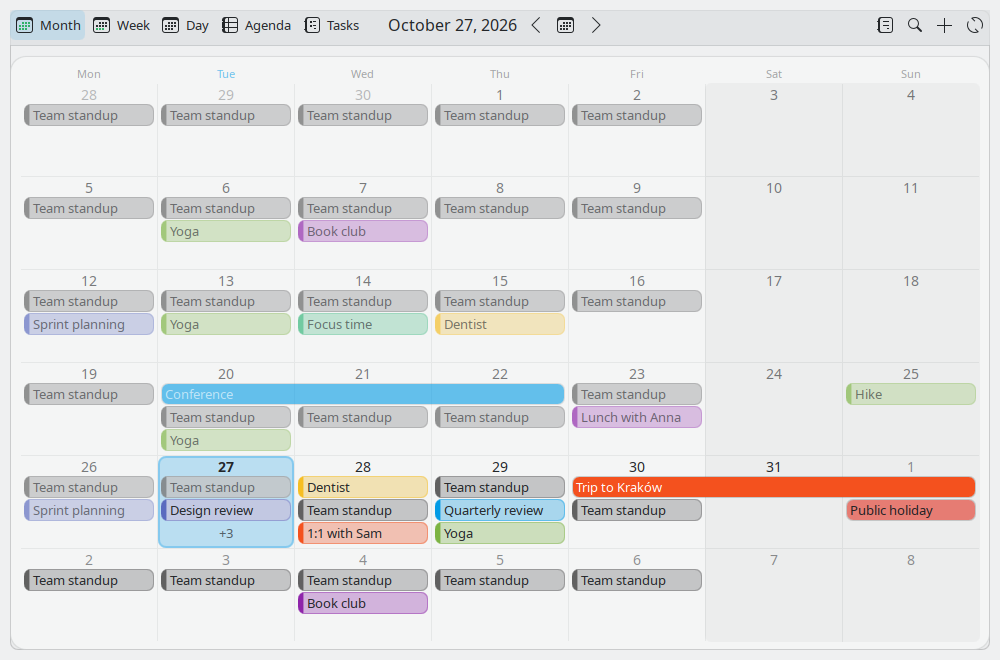
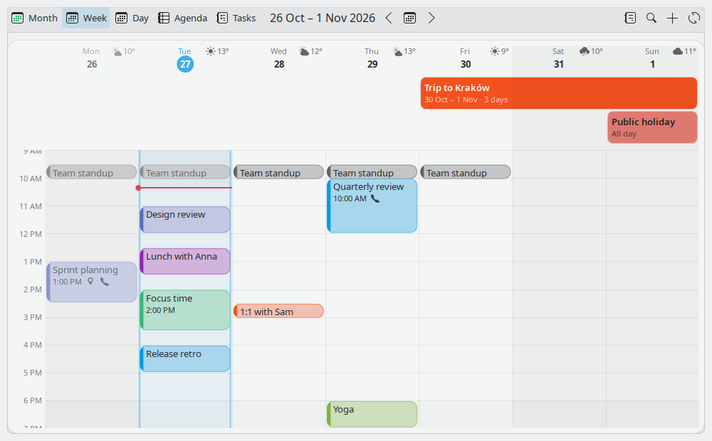
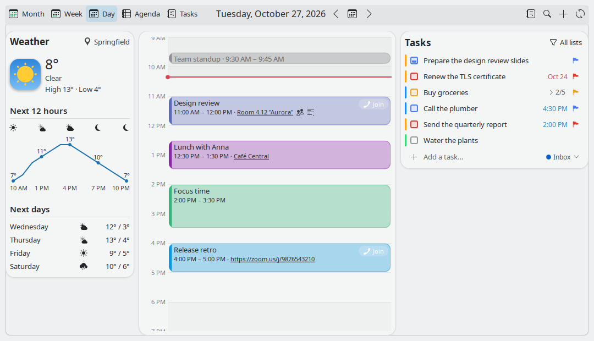
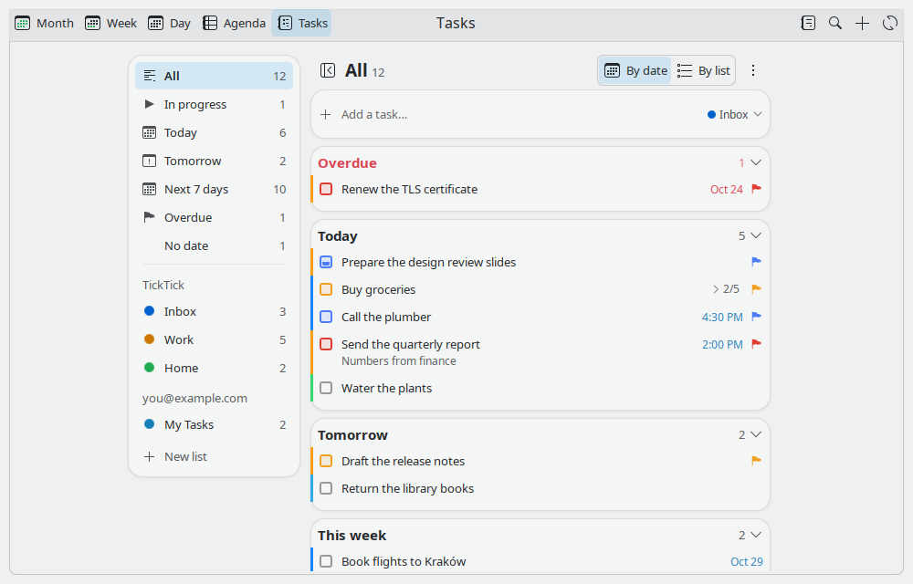
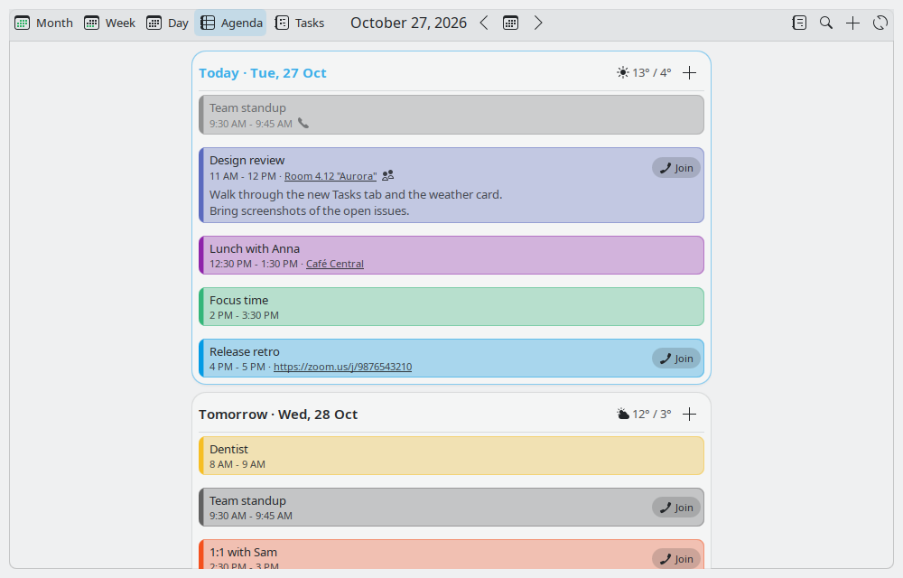
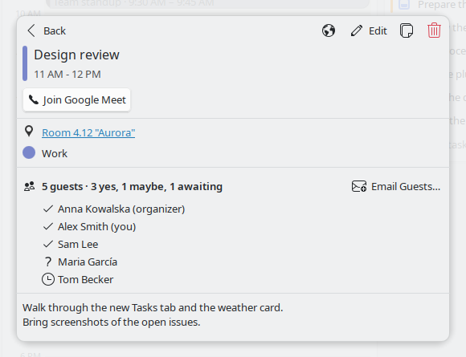
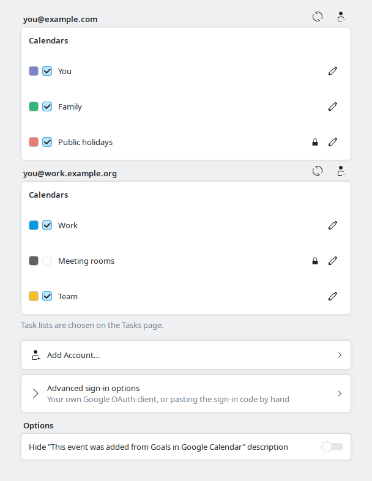
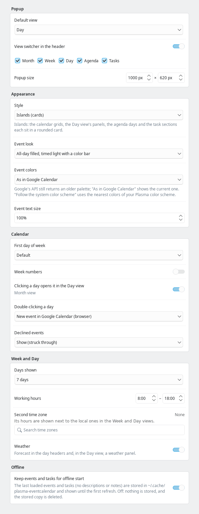

# Event Calendar for Plasma 6

[](https://github.com/divinae/plasma-applet-eventcalendar/actions/workflows/ci.yml)
[](https://ko-fi.com/divinae4535)

A calendar, agenda and weather widget for the KDE Plasma 6 panel that syncs with Google Calendar,
Plasma (Akonadi / holiday) calendars and iCalendar (.ics) files.

This is a maintained fork of [Event Calendar](https://github.com/Zren/plasma-applet-eventcalendar)
by Chris Holland (Zren), via [ALikesToCode's Plasma 6 port](https://github.com/ALikesToCode/plasma-applet-eventcalendar).
It keeps the same widget id, so it replaces an existing Event Calendar and keeps its settings.

## Features

- **Views** in the popup, switchable from its header: **Month** (event titles in the days,
  multi-day events as bars across them), **Week** and **Day** (an hour grid you can scroll through
  the whole day; drag events to move or resize them; the Day view has a weather panel for the day
  shown, and the day's tasks) and **Agenda** (a list of upcoming days), plus a **Tasks** tab. Drag events between days (Ctrl + drag copies),
  show or hide calendars from the header, a work week, a second time zone, keyboard navigation.
- **Islands style** (default, or flat): the month grid, the Week view's grid, the Day view's
  weather, hour grid and tasks, each agenda day and each section of the Tasks tab sit in their own
  rounded cards; task sections fold, and the done tasks wait in a folded "Completed" card.
- **Google Calendar**: several accounts at once, choose calendars and task lists per account.
  Create, edit and delete events with color, guests, Google Meet and **recurring events** (ends on
  a date / after N times, custom repeats; edit one occurrence or the whole series) and their own
  reminders. Quick add ("Lunch with Anna tomorrow 13:00"), search, duplicate events, answer
  invitations (Yes / Maybe / No), undo after a delete or move, rename and recolor calendars.
  Move events between calendars, busy / free and visibility, the event's time zone, out of office,
  focus time and working locations, attachments, Email Guests, Find a time (free slots for you and
  the guests), import .ics files. Tokens are kept in the system keyring.
- **Tasks** from Google Tasks and **TickTick** (or Dida365) in their own tab: smart filters (All,
  Today, Tomorrow, Next 7 days, Overdue, No date, each list), grouped by date or by list, sorted by
  due date, title, list or priority. **Add a task…** recognizes "tomorrow 17:00 !high #Work every
  week" as the day, time, priority, list and repeat. Priorities, due times, repeats, reminders,
  checklists (TickTick) and subtasks (Google); mark tasks in progress; set the priority and due
  date from the right-click menu; drag tasks between days, lists and accounts; undo,
  keyboard, search. Manage lists (rename, color, clear completed, delete, hide from the smart
  lists). Task reminders, a morning summary, and the day's tasks in the Day view. TickTick signs in
  with an API token, kept in the system keyring.
- **Meetings**: Join buttons for Google Meet, Zoom, Teams and other links, in the agenda, the
  Day view, the event details, notifications and the panel's right-click menu; Google Meet links
  can open in a Meet web app with a chosen Google account. The panel clock shows the next meeting
  ("in 5 min" / "12 min left", or above the time in a vertical panel); a meeting that ended early
  can be marked as ended. Music and videos pause when you join; optional Do Not Disturb during
  meetings and auto-join; overlapping meetings are marked.
- **Notifications** through KDE's notification system: reminders before events (with Snooze,
  optionally hidden after N seconds), when an event starts (optionally critical / persistent),
  new invitations for today (with Yes / Maybe / No) and a daily agenda, each configurable in
  System Settings > Notifications > Event Calendar. Clicking one opens the event in the widget.
- **Weather** from Open-Meteo (free, no API key; search your city in the settings), or
  OpenWeatherMap / Weather Canada.
- **Starts instantly and works offline**: the last loaded events and tasks are shown right away
  and stay visible offline (Settings > Views > Offline turns it off), fetches are retried automatically, and a banner shows when it can't connect.
- Invitations look like in Google Calendar (outlined / striped / struck through), events filled
  in their color or timed ones light with a color bar, icons for what an event has set, adjustable event text size, event locations open in Google Maps, dark theme
  friendly event colors, right-click menus on events, translated into 20 languages.

## Screenshots

All shots use mock data.

| | |
|---|---|
|  **Month**: event titles in the days |  **Week**: hour grid, all-day events, weather |
|  **Day**: weather, hours with Join buttons, the day's tasks |  **Tasks**: smart filters, priorities, in progress |
|  **Agenda**: each day a card |  **Event details**: location, guests, Join |
|  **Settings**: accounts and calendars |  **Settings**: views and appearance |

## Install

### From a release

Download the `.plasmoid` file from the [latest release](https://github.com/divinae/plasma-applet-eventcalendar/releases),
then:

```
kpackagetool6 -t Plasma/Applet -i eventcalendar-v1.6.0-plasma6.0.plasmoid
# or, to upgrade an installed Event Calendar:
kpackagetool6 -t Plasma/Applet -u eventcalendar-v1.6.0-plasma6.0.plasmoid
```

Restart Plasma (`systemctl --user restart plasma-plasmashell`) and add **Event Calendar** to a
panel (right click the panel > Add or Manage Widgets), or replace the Digital Clock with it.

### From source

```
git clone https://github.com/divinae/plasma-applet-eventcalendar.git eventcalendar
cd eventcalendar
sh ./install
```

`sh ./update` pulls and reinstalls; `sh ./uninstall` removes the widget. The scripts install the
dependencies below on Debian/Ubuntu, Arch and Fedora.

## Dependencies

- Plasma 6 (Qt 6 and KDE Frameworks 6)
- `python3`
- KNotifications QML module (`org.kde.notification`; Debian/Ubuntu:
  `qml6-module-org-kde-notification`, Arch: `knotifications`, Fedora: `kf6-knotifications`)
- Kirigami Addons (settings pages)
- `secret-tool` (libsecret) or KWallet, for storing Google tokens in the keyring

Optional:

- `pw-play` (PipeWire), `paplay` (PulseAudio) or `canberra-gtk-play`, for custom notification sounds
- iCalendar (.ics) files: the Python packages `icalendar>=6.1,<8` and
  `recurring-ical-events>=3.8,<4` (RRULE / RDATE / EXDATE / RECURRENCE-ID expansion). The install
  script puts them under `~/.local/share/plasma_org.kde.plasma.eventcalendar/python`.
- Akonadi / KDE PIM calendars: `akonadi` + `kdepim-addons`; creating local events: `konsolekalendar`

## Setup

1. Right click the widget > Configure Event Calendar.
2. **Google Calendar**: Sign in with Google. Your browser opens; after you allow access, the
   widget picks it up. Then choose the calendars to show for each account.
3. **Tasks**: choose the Google task lists to show. For **TickTick**, create an API token on the
   TickTick website (Settings > Account > API Token; dida365.com for Dida365), pick the server,
   paste the token and Connect, then choose the projects to show. TickTick's Open API only lists
   open tasks: a task you check off goes away at the next refresh.
4. **Weather**: search for your city (Open-Meteo).
5. **Views**: choose the default view, the popup size and the hours shown in the week view.

Plasma 5 is not supported; use the original [Event Calendar](https://github.com/Zren/plasma-applet-eventcalendar) there.

## Support

If the widget is useful to you, you can support this fork's development on
[Ko-fi](https://ko-fi.com/divinae4535). Donations go to this fork's maintainer, not to the
authors of the original Event Calendar (Chris Holland / Zren) or of the Plasma 6 port
(ALikesToCode) it builds on.

## Bugs and ideas

Report them in [GitHub Issues](https://github.com/divinae/plasma-applet-eventcalendar/issues): your distribution, the Plasma version, the widget version,
and for a problem in the settings or the popup the output of
`journalctl --user -b | grep -i eventcalendar`.

## Contributing

See [CONTRIBUTING.md](CONTRIBUTING.md). Tests: `for t in tests/*.test.js; do node "$t"; done`
and `python3 tests/*_test.py`. Translations live in `package/translate/` (see its ReadMe).

## License

GPL-2.0-or-later, like the original widget.
